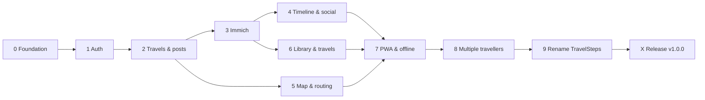

# Implementation plan – TravelSteps

Based on `../Functional requirements.md` and `../Technical requirements.md`.
Each phase delivers a working, deployable increment.

> ⚠️ **Before starting a new iteration, read [NEXT-ITERATION.md](NEXT-ITERATION.md)** – it lists
> pending improvements that must be implemented first. Empty it once they are done.

| Phase | Name | Result |
|-------|------|--------|
| 0 | [Foundation](Phase-0-Foundation.md) | Monorepo, Docker, CI-able build, empty app reachable via tunnel — ✅ done |
| 1 | [Authentication & users](Phase-1-Auth.md) | Secure login, forced credential change, user management — ✅ done |
| 2 | [Travels & posts (storage)](Phase-2-Travels-Posts.md) | Markdown storage, CRUD for travels/posts, stats — ✅ done |
| 3 | [Immich integration](Phase-3-Immich.md) | Photo picker, media proxy, galleries, read-only settings page — ✅ done (Immich API to be verified against live instance) |
| 4 | [Timeline, likes & comments](Phase-4-Timeline-Social.md) | Strava-like feed, post detail, social features — ✅ done |
| 5 | [Locations, routing & map](Phase-5-Map-Routing.md) | Locations, routed segments, map screen — ✅ done |
| 6 | [Picture library & travels overview](Phase-6-Library-Travels.md) | Fotobibliotheek, Reizen with summed stats, profile — ✅ done |
| 7 | [PWA & offline](Phase-7-PWA-Offline.md) | Installable, offline drafts, sync — ✅ done |
| 8 | [Multiple travellers](Phase-8-Multi-Traveller.md) | SQLite content, shared travels, blog selector, per-user Immich key, notifications, rich editor — ✅ done (push and the editor still to be tested on a real phone) |
| 9 | [Rename to TravelSteps](Phase-9-Rename-TravelSteps.md) | New name everywhere, existing data/drafts kept — ✅ done |
| X | [Hardening & release](Phase-X-Release.md) | Security review, backups, tests, docs, **v1.0.0** — ✅ done (manual on HA: fresh install from README, backup restore, update from 0.4.3; Playwright smoke not added) |

New phases are added before **X** (next number after the last one); X stays the final v1 step.

**V2** (multi-language, animations, trusted download, sharing, admin stats, …) is planned in [V2/README.md](V2/README.md)
– summary in [`../V2 roadmap.md`](../V2%20roadmap.md).

## Decisions taken (from Q&A)
- Login required to view anything.
- Own Docker container (no Nginx), port exposed for Cloudflare Tunnel, data on host volume.
- Node.js/TypeScript backend + React/Vite PWA.
- Immich proxied by backend; images never copied.
- Multiple photos per post, first is cover.
- Offline: text/stats/locations; photos picked when online.
- Routing per segment with transport mode; straight lines for plane/boat.
- Fixed stats + custom stats.
- Locations via GPS, map tap, search, photo EXIF.
- Library shows only photos used in posts.
- Comments: plain text, no threading.

### Changed by phase 8 (multiple travellers)
- Roles admin / traveller / viewer; travellers post (was: only admin).
- Travels have an owner, invited members (must accept) and their own viewer list (starts empty).
- "Whose blog" dropdown in the header (travellers + "Iedereen"); all pages follow it.
- No global active travel anymore; new posts default to the author's most recent ongoing travel.
- Immich API key per traveller (was: one global key); shared Immich URL.
- All content in SQLite (was: posts/travels in Markdown); one-time migration, no export.
- Notifications: Web Push + Meldingen page; subscribe per traveller; install banner on phones.
- WYSIWYG editor (Markdown storage) for post and travel descriptions.
- Comments: also deletable by post author and travel owner.
- Deleting a user with travels: delete, transfer or disable instead.

## Open points / assumptions
- Routing provider: OpenRouteService (free API key needed). Train uses straight line unless a rail router is added later.
- Immich API version: target the current stable API; verify endpoints during Phase 3.
- Profile picture for viewers: uploaded file stored in `/data/uploads/avatars`.
- No e-mail notifications in scope.
- iOS only delivers Web Push to PWAs installed on the home screen (iOS 16.4+).
- Editor: TipTap with Markdown output (chosen in phase 8).
- Application renamed to **TravelSteps** in phase 9.
- Version number: bump `version` in `code/config.yaml` (Home Assistant add-on store) together with
  `APP_VERSION` in `code/server/src/version.ts` for every release; v1.0.0 in phase X.
