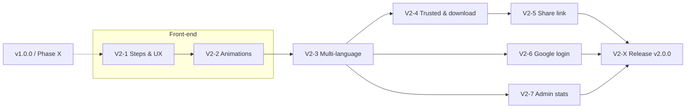

# V2 implementation plan – TravelSteps

Based on [`../../V2 roadmap.md`](../../V2%20roadmap.md). Same way of working as v1 (see
[`../README.md`](../README.md)): every phase delivers a working, deployable increment, and
[`../NEXT-ITERATION.md`](../NEXT-ITERATION.md) is still read first before each iteration.

> V2 is prepared while v1 is still being finished. V2 phases may start before
> [Phase X](../Phase-X-Release.md) is done; where a V2 phase touches the same screens as an open
> Phase X task, that is noted in the phase file.

| Phase | Name | Result | Version |
|-------|------|--------|---------|
| V2-1 | [Steps & UX polish](V2-1-Steps-UX.md) | "Post" becomes "Stap" in the UI, prettier blog selector with avatars, uniform components | 1.1.0 ✅ |
| V2-2 | [Event animations](V2-2-Animations.md) | Footprints, plane, heart burst, confetti | 1.2.0 ✅ (fixes 1.2.1) |
| V2-3 | [Multi-language](V2-3-I18n.md) | Dutch + English, per user, also push texts | 1.3.0 |
| V2-4 | [Trusted users & original download](V2-4-Trusted-Download.md) | Traveller marks users as *Vertrouwd*; they can download originals | 1.4.0 |
| V2-5 | [Anonymous share link](V2-5-Share-Link.md) | 24h public card with one step, revocable | 1.5.0 |
| V2-6 | [Google login](V2-6-Google-Login.md) | "Inloggen met Google" for users who linked their account | 1.6.0 |
| V2-7 | [Admin statistics](V2-7-Admin-Stats.md) | Beheer → Statistieken: users, content, storage | 1.7.0 |
| V2-X | [Hardening & release v2.0.0](V2-X-Release.md) | Security review of all V2 features, docs, **v2.0.0** – always last | 2.0.0 |

New V2 phases are added before **V2-X**. Version numbers are indicative; bump `code/config.yaml`
and `APP_VERSION` together as in v1.

V2-1 and V2-2 are grouped as the front-end block: both are pure UI work (no API/DB changes), and
the animations reuse the design tokens and components from V2-1. Animations add no visible text,
so they can safely come before V2-3. V2-3 then comes before the remaining features, because those
add UI texts that are written in both languages from the start. V2-6/7 are independent of each
other and of V2-4/5.

## Decisions taken (from Q&A, 2026-10-08)
- **Wording:** "post" → **"stap" / "step"** in the UI only. API routes, database tables, code
  names and URLs (`/post/:id`, `/posts/nieuw`, …) stay unchanged for compatibility.
- **Languages:** Dutch (default) + English. Chosen **per user** in Profiel; first default from the
  browser language, fallback Dutch. Push notifications follow the recipient's language. User
  content (titles, texts) is not translated.
- **Trusted ("Vertrouwd" / "Trusted"):** one per-user grant. A traveller marks other users as
  trusted; a trusted user may (a) download that traveller's photos in **original quality** – single
  photo only – and (b) create **share links** for that traveller's steps. The grant covers all
  photos/steps that traveller added, but only in travels the trusted user may see. Authors can always
  do both for their own photos/steps; the admin can do everything.
- **Share link:** anonymous page with one step: title, date, text, photos (preview size), stats and
  route map. **No** author name, comments, likes, travel or other steps. Valid **24h, fixed**;
  revocable early by the creator, the step author and the admin; shows "verlopen" afterwards.
- **Animations:** footprints on a new step, plane on a new travel, heart burst on a like, confetti
  on accepting an invitation. Short, non-blocking, disabled with OS "reduce motion".
- **Google login:** extra option next to username/password. Only **existing** users who **linked**
  their Google account in Profiel (after a normal login) can use it. Unknown Google accounts are
  refused; no self-registration.
- **Admin stats:** users per role and active in the last 30 days, travels, steps, photos, likes,
  comments, `/data` disk usage (database, avatars, backups) and total size of the Immich photos
  referenced by TravelSteps.
- **Order:** front-end block first (V2-1 → V2-2), then V2-3 → V2-4 → V2-5 → V2-6 → V2-7 → V2-X
  (updated 2026-10-09: animations moved next to UX polish).

## Compatibility rules (apply to every V2 phase)
Everything from v1 must keep working. Each phase file has its own "Compatibility" section; these
rules apply globally:

1. **Data:** schema changes only via the append-only migration list (`PRAGMA user_version`). No
   destructive migrations; existing users, travels, posts, likes, comments, subscriptions,
   notifications and push subscriptions survive an update. Backup stays "copy `/data`".
2. **Roles unchanged:** admin / traveller / viewer and the "may see a travel" rule stay the single
   source of truth. Every new permission (trusted, share, download, stats) is checked **on top of**
   that rule, never instead of it.
3. **API backwards compatible within V2:** existing endpoints keep their paths and response shapes
   (fields may be added). An installed PWA with an old service worker and **offline drafts in the
   outbox** must still sync after the server is updated.
4. **URLs stable:** links in existing push notifications, bookmarks and the in-app notification list
   (`/post/:id`, `/reizen/:id`, …) keep working.
5. **Offline/PWA:** new features must not break offline drafting. Things that require the network
   (Google login, sharing, original download, admin stats) are hidden or disabled offline with a
   clear message. Private or expiring data (originals, share endpoints) is **never** cached by the
   service worker.
6. **Configuration:** new env vars / Home Assistant options are optional; the app starts and behaves
   as before when they are empty (e.g. no Google button without a client ID).
7. **Security baseline:** CSRF header, session cookie flags, rate limiting, CSP, sanitized Markdown
   and encrypted Immich keys stay in place. Public endpoints (share link) are the only exception to
   "login required" and are explicitly whitelisted.
8. **User deletion:** the existing delete / transfer / disable flow also cleans up the new data
   (trusted grants, share links, Google identities, language, stats caches).
9. **Docs:** when a phase is done, update `Functional requirements.md`, `Technical requirements.md`
   and `code/README.md` (env/options) and mark the phase ✅ here.

## Permission overview after V2
| Action | Admin | Step author | Trusted by author | Travel owner | Other user who may see the travel | Anonymous |
|--------|:-----:|:-----------:|:-----------------:|:------------:|:---------------------------------:|:---------:|
| View step (in app) | ✅ | ✅ | ✅* | ✅ | ✅ | – |
| Download original photo | ✅ | ✅ | ✅* | – | – | – |
| Create share link | ✅ | ✅ | ✅* | – | – | – |
| Revoke share link | ✅ | ✅ | own links | – | – | – |
| View share card | – | – | – | – | – | ✅ (valid token, 24h) |
| Admin statistics | ✅ | – | – | – | – | – |

\* only when the trusted user may also see the travel.

## Open points / assumptions
- Travel owner is **not** automatically allowed to download/share other members' photos; they need
  the trusted grant like everyone else (follows "same permission as download").
- The step author gets an in-app notification when someone else shares their step (privacy).
- iOS standalone PWAs and Google OAuth: the redirect may open Safari, whose cookies are separate from
  the PWA – see risks in V2-6. Password login always remains available.
- Share-link previews in chat apps (WhatsApp, …) only show a generic TravelSteps card, never step
  content, because content is only fetched with JavaScript after opening.
