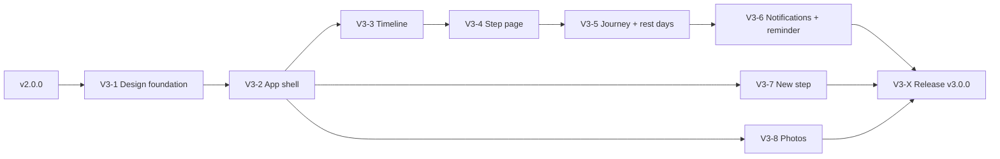

# V3 implementation plan – TravelSteps

Based on [`../../V3 roadmap.md`](../../V3%20roadmap.md) and the design mockup
([canvas](https://claude.ai/code/artifact/e054cb08-390d-44e5-b521-642bb1c127f5), page
*Improvements*; the page *As is* shows the v1.4.0 screens it starts from). Same way of working as
v1 and V2: every phase delivers a working, deployable increment, and
[`../NEXT-ITERATION.md`](../NEXT-ITERATION.md) is read first before each iteration.

| Phase | Name | Mockup boards | Result | Version |
|-------|------|---------------|--------|---------|
| V3-1 | [Design foundation "Reisdagboek"](V3-1-Design-Foundation.md) | Design language, Improvements overview | New tokens, fonts, type scale and components applied to every screen; travel colour; map line styles | 2.2.0 ✅ (with V3-2) |
| V3-2 | [App shell & "Wat wil je zien?"](V3-2-App-Shell.md) | Breakpoints, Wat wil je zien?, nav of every board | Four tabs + bell, rail, sidebar; one context bar + sheet | 2.2.0 ✅ |
| V3-3 | [Timeline](V3-3-Timeline.md) | Timeline, Timeline · 160 % text, Tablet portrait · timeline, Desktop · feed + map | New step cards, route line between cards, wide layouts | 2.3.0 ✅ |
| V3-4 | [Step page](V3-4-Step-Page.md) | Step page, Tablet landscape · step | Diary page with previous/next | 2.4.0 ✅ |
| V3-5 | [Travel as a journey](V3-5-Journey.md) | Travel as a journey, Desktop · travel as a journey | Route list, rest days, new totals | 2.5.0 ✅ |
| V3-6 | [Notifications & day reminder](V3-6-Notifications-Reminder.md) | Notifications | Grouped list, reminder for empty travel days | 2.6.0 |
| V3-7 | [New step from photos](V3-7-New-Step.md) | New step from photos | Three-part step editor with suggestions from photos | 2.7.0 |
| V3-8 | [Photos](V3-8-Photos.md) | Desktop · photos | Photos per step, slideshow | 2.8.0 |
| V3-X | [Release v3.0.0](V3-X-Release.md) | all | Audit, upgrade test, docs, **v3.0.0** – always last | 3.0.0 |

**Why this order.** V3-1 changes the tokens and base components, so every later phase builds on
the final look instead of restyling twice; at the end of V3-1 the whole app already looks like the
new design, with the old layouts. V3-2 changes the frame every page sits in (navigation,
breakpoints, pickers), so the page phases after it only touch their own page. Each page phase
delivers its phone, tablet and desktop layout together, so no page is reworked twice. V3-3 (cards,
day badge, route connector) comes before V3-4 and V3-5, which reuse those pieces. V3-6 needs the
rest days from V3-5. V3-7 and V3-8 depend only on V3-2 and may be done in any order after it.

## Decisions taken (Q&A, 2026-10-30)
- **Day reminder:** on by default for travellers who may post in an ongoing travel; sent at
  **21:00** in the user's own time zone; on/off and time adjustable in **Profiel › Meldingen**.
- **Rest days:** any user who may post in the travel can mark a day as rest day; it then counts for
  everyone (no reminder, shown as "rustdag" in the journey). Unmarking is allowed for the same
  users.
- **Drafts:** "Bewaar als concept" stays **local** (the existing offline outbox / IndexedDB). No
  server-side draft status.
- **Travel colour:** a new optional colour per travel, **chosen in the travel editor** from a
  named palette. Existing travels get the colour they show today, so nothing changes visually
  for them at the upgrade.
- **Base map:** keep OpenStreetMap tiles and **warm them with a CSS filter**. No new tile
  provider, no new CSP host.

## Decisions taken by default (change them before the phase starts if needed)
- **Fonts are self-hosted** (WOFF2 bundled via `@fontsource`), not loaded from Google Fonts: the
  CSP stays as it is, the PWA works offline and no visitor IP goes to Google.
- **Floating buttons:** the v1.2.2/1.2.3 feedback asked for FABs. The mockup replaces the step
  page's three-dot FAB menu with a visible **Bewerken** button and moves "Nieuwe stap" into the
  header on tablet and the sidebar on desktop. On the **phone the "Nieuwe stap" FAB stays**.
  Deleting a step moves to the bottom of the step editor (danger zone).
- **Wording:** the mockup is in Dutch; every new text is written in Dutch and English from the
  start (`nl.ts` stays the base). New labels: "Op eigen kracht" / "Under your own power",
  "Totaal onderweg" / "Total travelled", "Rustdag" / "Rest day", "Wat wil je zien?" / "What do
  you want to see?".
- **Versions:** each phase bumps the minor version (2.1.0 … 2.8.0); V3-X releases **3.0.0**.

## Guardrails (from the mockup, apply to every phase)
- Text follows the device setting (rem/em only). Every screen is checked at **100, 130, 160 and
  200 %** text size.
- Body 17 px, nothing smaller than 15 px at 100 %. Navigation labels grow to 125 % and then stop.
- Tap targets at least **48 px**, and a word next to every icon (icon-only only with
  `aria-label` and only where the mockup shows it, e.g. close).
- Contrast **4.5:1** or more for all text; meaning is never carried by colour alone (map lines
  also differ in thickness/dash, travel colours always come with the name).
- No text on top of photos. Layouts wrap instead of cutting text off. One main button per screen.
- Breakpoints are in **em** (phone < 37.5 em, tablet 37.5–68.75 em, desktop ≥ 68.75 em), so a
  larger text size automatically falls back to a narrower layout.
- Animations from V2-2 stay and still respect "reduce motion".

## Compatibility rules (apply to every V3 phase)
The V2 rules stay in force ([V2 README](../V2/README.md#compatibility-rules-apply-to-every-v2-phase)).
In short, and what they mean for V3:

1. **Data:** only append-only migrations. V3 adds: travel colour, rest days, reminder preferences
   and time zone per user, notification type `reminder`. Nothing is dropped or rewritten.
2. **API backwards compatible:** existing endpoints keep paths and shapes; new fields are optional.
   An installed PWA with an old service worker and outbox drafts must still sync.
3. **URLs stable:** `/`, `/post/:id`, `/reizen/:id`, `/meldingen`, `/posts/nieuw`, … keep working.
   `/meldingen` stays a route even though it is no longer a tab.
4. **Offline:** the new step editor, rest-day marking and notification settings work offline as far
   as today's features do; photo suggestions need the network and say so.
5. **localStorage keys** for the selected travel and blog keep their key and value format; the new
   sheet reads and writes the same keys.
6. **Configuration:** no new required options. The reminder uses the user's time zone, falling back
   to `TZ`.
7. **Docs:** after each phase update `Functional requirements.md`, `Technical requirements.md`,
   `README.md` + `README.nl.md` when behaviour or options change, `code/CHANGELOG.md` with
   screenshots, and mark the phase ✅ here.
