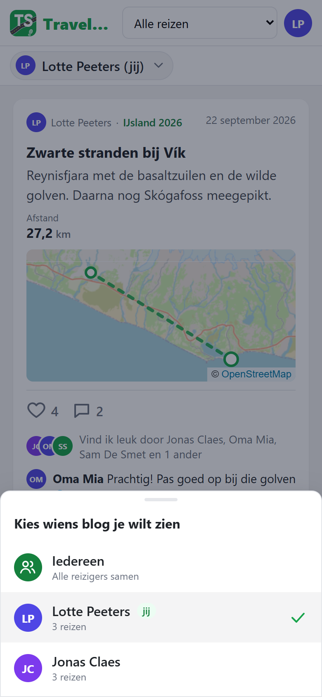
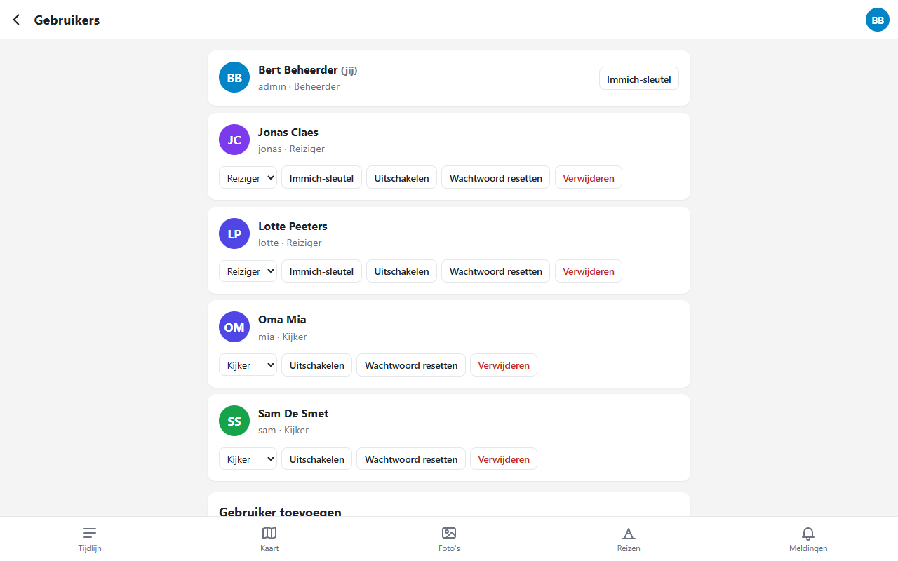
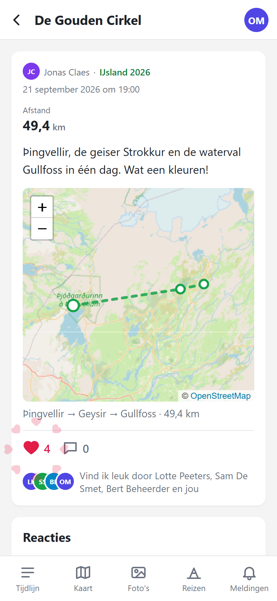
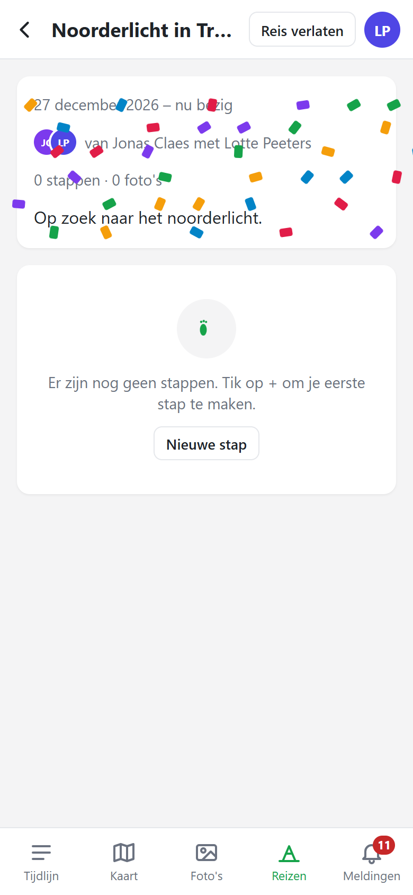
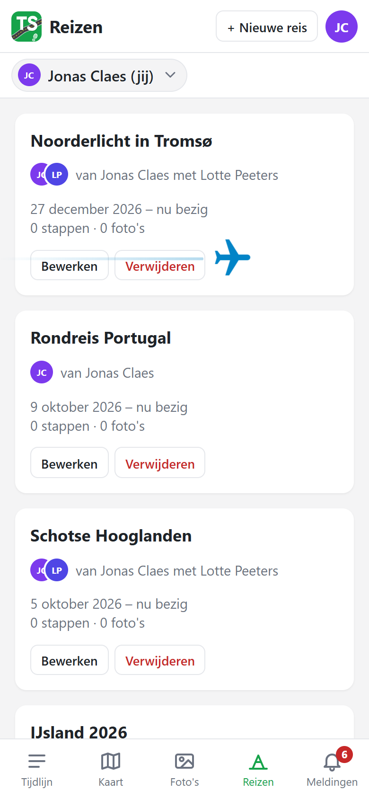
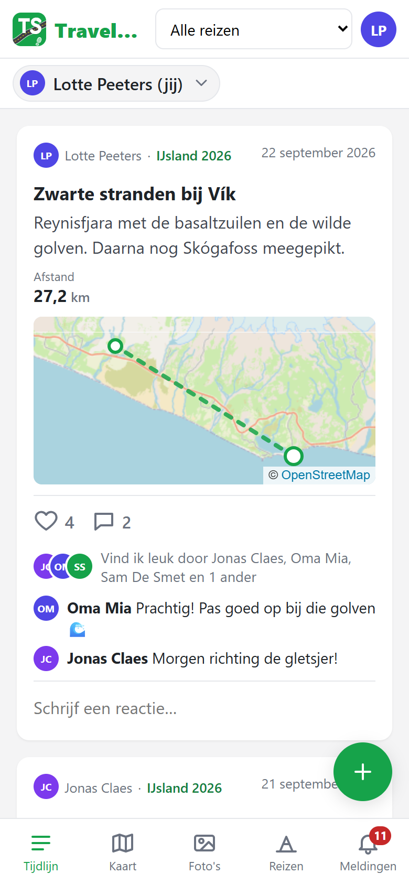
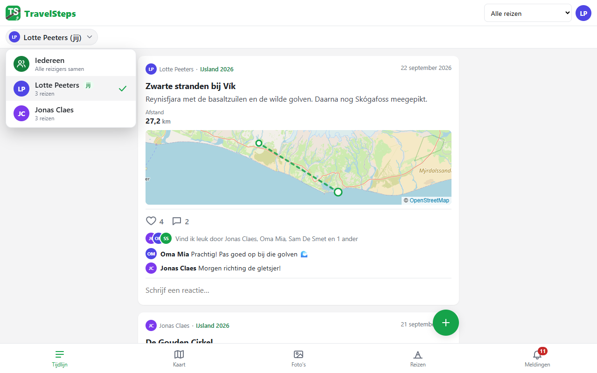
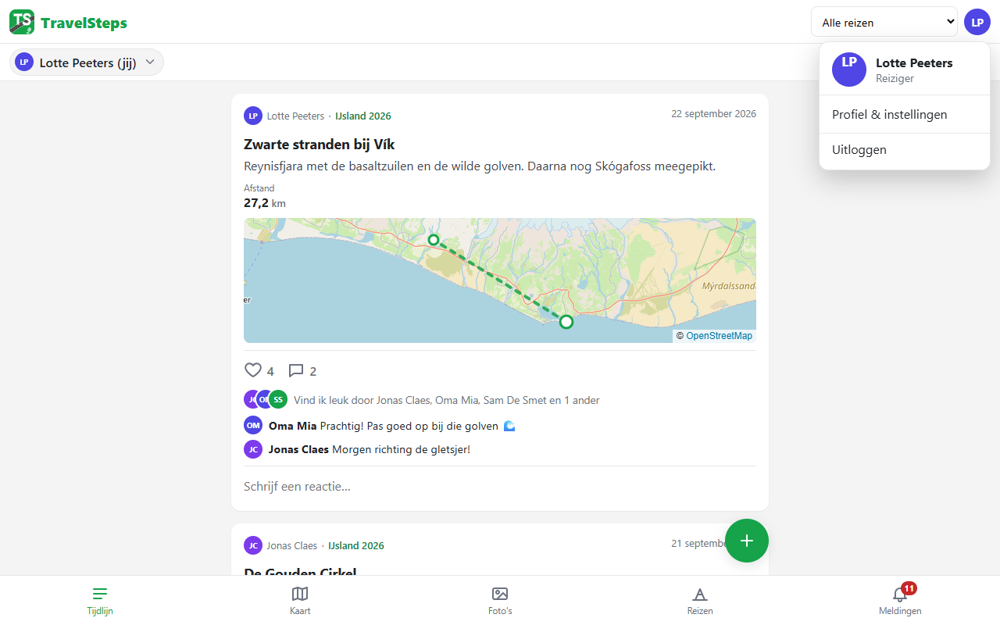
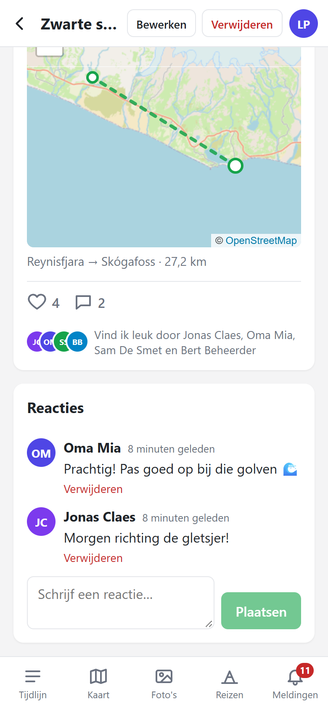
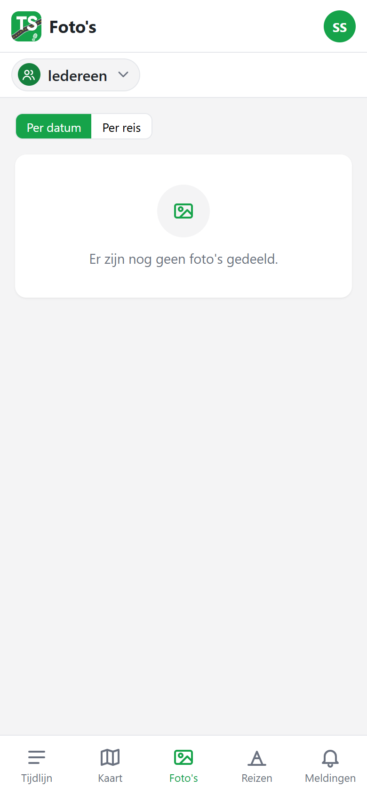

# Changelog

All notable changes to TravelSteps. Versions follow `major.minor.patch`: a release raises the
major number, a completed phase the minor number and a bug fix the patch number. Screenshots are
in [`docs/changelog`](docs/changelog).

## 2.5.0 – A travel as a journey (V3-5)

- **The travel page tells the trip day by day:** under the header (name, "4 – 16 July 2026 · 13
  days", the travellers) a list called **The journey** shows every day from the start date to the
  end date (or to today for an ongoing travel) on one route line: steps with their photo, day and
  "Walking · 3.2 km · 448 m", how you got to the next step ("By car · 23 km"), and the days without
  a step. The newest step has a sunset-coloured dot. A summary says "7 days with a step · 2 rest
  days · 4 still empty".
- **Rest days:** an empty day shows **Add step** (opens a new step on that day) and **Rest day**.
  A rest day reads "Rest day, left empty on purpose" and can be undone. Consecutive empty or rest
  days are grouped ("Day 7 and 8"). Everyone who may write in the travel (and the admin) can mark
  them; everyone who can see the travel sees them. A step on a rest day always wins. Marking needs
  a connection.
- **Totals that say what they count:** "Under your own power" (walking and cycling), "Total
  travelled" (also car, boat, train and plane), "Climbed" with the highest point, and the number of
  steps and photos plus your own figures ("and 3 waffles"). This replaces the confusing
  "Travelled" next to "Distance".
- **Edit** is a visible button at the top; on phones **New step** stays as the round button.
- **Computer:** the route list on the left and a large map on the right. Clicking a step chooses
  it – highlighted in the list and on the map, with a preview card and **Open step**; clicking it
  again opens it. Clicking a step on the map chooses it in the list.
- The full feed of a travel is still on the timeline (choose the travel at the top).
- **Large text (checked at 160 % on a phone):** spacing, icons, page margins and the minimum
  48 px button height stay fixed, so a larger text size gives the words the room instead of the
  padding. The phone header no longer squeezes "All travels" to one letter per line; on the step
  and travel pages the bar shows only the back link and **Edit** (like the design), with text that
  grows up to 125 %. Route-list rows and step cards put the photo above the text when needed.

## 2.4.0 – The step page (V3-4)

- **A step reads like a diary page:** the photo with small photos under it to switch, the day
  ("Day 4 · Tue 7 July · 16:20"), "by Lies", the title and the places. The story is in a calm,
  slightly larger reading column.
- **Figures as tiles with a word that fits:** "48 km cycled", "620 m climbed", "4:05 h on the way",
  "17 °C temperature"; the word follows how you mostly travelled that day (walked, cycled, driven,
  by boat, …). Your own figures are marked "own figure".
- **Map** with "3 places · cycling route" and a **Large map** link that opens the map zoomed in on
  this step.
- **Comments as a conversation:** others on the left, yours on the right in green, with a clearly
  labelled field ("Your comment to Lies") and a big **Send** button.
- **Previous step / Next step** at the bottom, in the order of the travel.
- **Edit** is now a button at the top (only if you may edit); **Delete step** moved to the bottom
  of the step editor, with the same confirmation.
- **Tablet and computer:** story on the left, figures, map, likes and the next step on the right.
- The back link at the top names where it goes ("‹ Lofoten & Senja").

## 2.3.0 – Timeline (V3-3)

- **Photo first:** a step card starts with the photo (dots show how many there are – no text on
  the photo), then a day badge "Day 6 · Thu 9 July", who wrote it and when, the title, the places
  ("Ramberg → Leknes → Haukland beach"), a short piece of the story and the figures as small chips
  with an icon (48 km, 620 m, 4:05 h, 17 °C, "Waffles 3").
- **A small map only when the step has a route** (two places or more), with "3 places · cycling
  route" under it.
- **Like · 3** and **Comment · 1** are big buttons with a word, and the likes say who:
  "Marleen, Jonas and Lies like this". **Comment** opens the step at the comment field. The comment
  box and the latest comments are no longer on the card.
- **Route line between steps:** a dashed line with how you travelled to the next step and when,
  e.g. "By car · 35 km · 2 days earlier" (not between steps of different travels).
- **Tablet:** cards in two columns (one column again with large text).
- **Computer:** the timeline with a map next to it that follows the step you are reading: it zooms
  to that step, draws it in sunset orange and labels it "The step you are reading". Clicking a step
  on the map scrolls the timeline to it. With "reduce motion" on, the map jumps instead of gliding.
- Zoom buttons on all maps are now 48 px and at the top right.

## 2.2.0 – New look and navigation (V3-1, V3-2)

- **New look "Reisdagboek":** warm paper background, forest green and a sunset accent, and two new
  fonts: Bricolage Grotesque for headings and Atkinson Hyperlegible Next (made for readers with
  low vision) for everything else. The fonts come with the app, so nothing is loaded from Google
  and they work offline.
- **Easier to read and tap:** text follows the text size of your device, nothing is smaller than
  15 px, every button and row you can tap is at least 48 px high and all text has a contrast of
  at least 4.5:1 (checked by a test).
- **A colour per travel:** choose it in the travel editor (Forest, Fjord, Sunset, Heather, …). It
  is used for the travel's line on the map and the ring around its cover. Existing travels keep
  the colour they had on the map.
- **Map:** lines show how you travelled – walking and cycling thick and solid, car thinner and
  lighter, boat, train and plane dashed in blue – with a legend under the map. The base map is
  warmer and calmer, so the routes stand out.
- **Navigation:** four tabs (Timeline, Map, Photos, Travels); notifications moved to a bell with
  a count at the top. On a tablet the navigation is a rail on the left, on a computer a sidebar
  with "New step" and your profile. Larger text automatically switches to the narrower layout.
- **"What do you want to see?":** one bar at the top of the timeline, map and photos shows the
  travel and whose diary you are looking at ("Lofoten & Senja · Day 6 · Bert and Lies"). Tapping
  it opens one sheet with both choices and a "Show 7 steps" button. The photos page now also
  follows the chosen travel, and the choice is remembered on the device. The bell to follow a
  traveller moved into this sheet.

## 2.0.0 – TravelSteps 2

- **Version 2:** brings together everything since 1.0.0 – steps & UX polish (1.1), animations
  (1.2), Dutch and English (1.3) and trusted people with original downloads (1.4). Existing data,
  sessions, push subscriptions and offline drafts are kept. Sharing a step via a link and admin
  statistics are postponed to a later version.
- **Security:** updated `fastify` and `fast-uri` (security advisories); a test now checks that
  only the health check, login and logout can be reached without logging in.
- **Wording:** the trusted-people explanation in Profile says "steps" instead of "posts".

## 1.4.0 – Trusted people and original downloads

- **Download original:** the photo viewer has a **Download original** button that saves the photo
  in full quality with its original file name. It replaces the old author-only "Open original"
  link and is hidden while offline.
- **Trusted people:** travellers can mark people as trusted in Profile → Trusted people. Only people
  who can see at least one of your travels can be added. Trusted people may download the originals
  of your photos, but only in travels they can see. Revoking works immediately.
- **Privacy:** others (also co-writers and viewers) can no longer request originals; originals are
  never stored in the offline cache.

## 1.3.0 – Dutch and English

- **English:** the whole app is now available in English as well as Dutch – every screen, dialog,
  message, editor button and empty state. Dates and numbers follow the language; units stay metric.
- **Choose your language** in Profiel → Taal / Language. The choice is saved with your account, so
  it follows you to every device and after logging in again. Changing it offline works too; it is
  saved as soon as you are back online.
- **Login screen toggle:** a small NL / EN switch on the login screen, remembered on that device.
  Before you choose, the browser language decides (English browsers get English).
- **Notifications in your language:** push notifications are sent in the language of the person
  who receives them.
- **Docs:** the documentation now lives in the main `README.md` (English) and `README.nl.md`
  (Dutch).

## 1.2.9 – Security updates

- **Security:** updated dependencies (`zod` 4, `@fastify/rate-limit` 11) from the automatic
  security fix on GitHub.
- **Fix:** the server builds again with `zod` 4 (the `COOKIE_SECURE` / `TRUST_CLOUDFLARE`
  defaults); behaviour is unchanged.

## 1.2.8 – Faster locations, one-day steps

- **One-day travels:** a step in a travel of one day has no date picker any more – only the time,
  with a hint on which day the step is.
- **Locations feel instant:** a place picked on the map (or via GPS / photos) appears right away;
  its place name is filled in as soon as it is found ("Plaatsnaam zoeken…").
- **Loading overlay on the map** while a place is searched, located, named or the route is
  calculated, so it is clear something is happening.
- **Faster place lookups:** the server gives up on a slow place-name service after 6 seconds
  (was 20) and remembers recent answers, so repeated searches and taps are immediate. The route is
  calculated sooner after a change.

## 1.2.7 – Map stays inside its box

- **Fix:** pressing "Kies op kaart" in the step editor no longer makes the map spill out of its
  card. Switching the pick mode used to remove Leaflet's own styling from the map, so the map tiles
  were no longer clipped.

## 1.2.6 – One-day travels

- **One-day travel:** the travel editor has a "Duur" choice: _Eén dag_ or _Meerdere dagen_. With
  _Eén dag_ you only pick one date; the travel is saved with the same start and end date.
- One-day travels show a single date (e.g. "9 oktober 2026") instead of a range in the travel
  list, the travel page and the header travel picker.

## 1.2.5 – Date pickers, admin panel and fixes

- **Fix:** an active style button (bold, heading …) in the text editor no longer turns invisible
  when you hover over it.
- **Fix:** "Kies op kaart" now has a map icon, and the green highlight stays inside the map
  instead of sticking out of the card.
- **Fix:** "Aankomst vanaf vorige stap" can only be chosen once the step has a place; until then
  it is disabled with a hint (before, your choice was undone immediately).
- **Pretty date and time pickers:** the step date opens a month calendar and an hour/minute
  chooser; the travel start and end dates use the same calendar (with "Nog bezig" to clear the
  end date).
- **Beheerpaneel:** the admin "Instellingen" menu is now called "Beheerpaneel".
- **Photo integration key:** setting a traveller's Immich API key opens a proper dialog instead
  of a browser prompt, with save and remove buttons.
- **Copy password:** when creating a user (and after creating or resetting) a "Kopiëren" button
  copies the temporary password.

## 1.2.4 – Pretty dropdowns and photo integration

- **Fix:** the step actions button no longer shows its menu all the time; it opens on a tap.
- **Pretty dropdowns everywhere:** every choice list now opens the same app-style list (a bottom
  sheet on phones). The travel in the step editor shows its cover photo, dates and number of
  steps; the arrival and the transport mode between locations under the map show an icon per mode
  (walk, bike, car, train, plane, boat); roles, the travel transfer when deleting a user and the
  invite list show icons or profile pictures.
- **Photo integration:** the "Immich" menu item and labels are now called "Foto-integratie".

## 1.2.3 – Header travel picker, step actions and settings menus

- **Travel filter in the header:** on the timeline and the map the travel choice ("Alle reizen",
  "IJsland 2026" …) is now a picker on the left of the header, opposite your profile picture. It
  shows the cover photo (or map colour), dates and number of steps of every travel.
- **Step actions button:** on a step, the floating button opens a small menu with "Stap bewerken"
  and "Stap verwijderen"; the delete button at the top right is gone.
- **Confirm dialog:** opens and closes with a smooth animation, always has a title (for example
  "Stap verwijderen?"), a coloured icon and icons on the buttons.
- **Profile and settings menus:** the profile page is now a clear menu – name and profile photo,
  password, Immich, notifications, app installation, admin and log out – each opening its own
  page. The admin settings are split the same way into general, services and values. The profile
  menu at the top right shows icons.

## 1.2.2 – Floating buttons, icons and full-screen animations

- **Floating action buttons:** adding and editing no longer hide behind small white buttons at
  the top right. "Nieuwe reis" (travels), "Nieuwe stap" (timeline and travel page – the travel is
  pre-selected) and "Bewerken" (travel and step) are now big floating buttons above the bottom
  navigation.
- **Icons on buttons:** edit, delete, leave, accept/decline, save, publish, send, invite, cover
  photo, location search and the admin actions show an icon next to their label. Delete and leave
  have a red tint.
- **Full-screen animations:** creating a travel first shows a big plane flying across the screen
  for one second, creating a step shows big footprints walking across it; only then is it saved.
  A like shows a big heart in the middle of the screen, accepting an invitation a full-screen
  confetti rain. With "reduce motion" there are no animations and no waiting.

## 1.2.1 – Layout fixes

- **Blog selector on phones:** the bottom sheet was drawn underneath the bottom navigation and the
  "+" button, so the last travellers in the list could not be tapped. The sheet now covers both.
- **Users page (admin):** with the new avatars the name column was squeezed next to the buttons;
  the buttons now wrap onto their own line when space is short.
- **Step header:** on narrow screens the author, travel and date no longer squeeze into narrow
  columns; the date moves to its own line.

| Blog selector on a phone                                                                              | Users page                                                                                         |
| ----------------------------------------------------------------------------------------------------- | -------------------------------------------------------------------------------------------------- |
|  |  |

## 1.2.0 – Animations (V2 phase 2)

Small, cheerful animations for the moments that matter. They play once, never block the page,
and are skipped entirely when the device asks for reduced motion.

- **Like:** a burst of hearts around the heart button (only when liking, not when un-liking).
- **New step:** footprints walk across the screen after publishing a step (also when it is saved
  offline and sent later).
- **New travel:** a plane flies across the screen after creating a travel.
- **Invitation accepted:** confetti when you join a travel, from the travel page or from
  Meldingen.

| Like                                                                                             | Invitation accepted                                                                                                 | New travel                                                                                                  |
| ------------------------------------------------------------------------------------------------ | ------------------------------------------------------------------------------------------------------------------- | ----------------------------------------------------------------------------------------------------------- |
|  |  |  |

## 1.1.0 – Steps & UX (V2 phase 1)

- **"Posts" are now "stappen":** every text in the app, the push notifications and the error
  messages talks about _stappen_ ("Nieuwe stap", "Er zijn nog geen stappen", …). Links and saved
  data are unchanged.
- **Avatars everywhere:** every person gets a round avatar with their initials and a fixed
  colour (or their photo). They appear on steps, comments, travels, the users page and as a small
  stack next to "Vind ik leuk door …".
- **New blog selector:** choose whose blog you see from a list with avatars, "(jij)" for yourself
  and the number of travels per traveller. A dropdown on a computer, a bottom sheet on a phone;
  fully usable with the keyboard.
- **Avatar menu:** the menu behind your avatar (profile, admin, log out) got the same new style.
- **Loading and empty pages:** instead of "Laden…" you see grey placeholders in the shape of the
  content, and empty pages show an icon with a short explanation and, where useful, a button.
- **More consistent look:** shared colours, spacing, rounded corners and shadows across all pages.

| Timeline                                                                                    | Blog selector (computer)                                                                            | Avatar menu                                                                          |
| ------------------------------------------------------------------------------------------- | --------------------------------------------------------------------------------------------------- | ------------------------------------------------------------------------------------ |
|  |  |  |

| Step with likes and comments                                                         | Loading                                                                                                   | Empty page                                                                                   |
| ------------------------------------------------------------------------------------ | --------------------------------------------------------------------------------------------------------- | -------------------------------------------------------------------------------------------- |
|  |  |  |

## 1.0.0 – First release

- Security review fixes, `npm audit` clean.
- Nightly database backups (`backup_keep`), status on the Instellingen page and a restore
  procedure in the README.
- More descriptive notifications (comment text, step/travel excerpt).
- Compression, lazy-loaded thumbnails and code-split pages for faster loading.
- App icon in the header; the Profiel tab is replaced by the avatar menu.

## 0.4.x and earlier

Development versions (phases 1–9): see the phase files in the `Analysis` folder.
